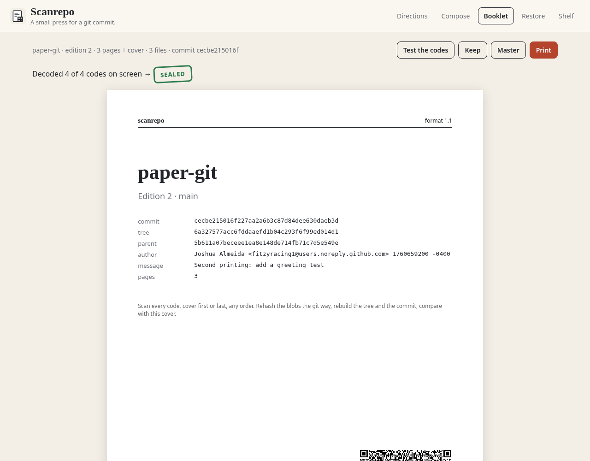
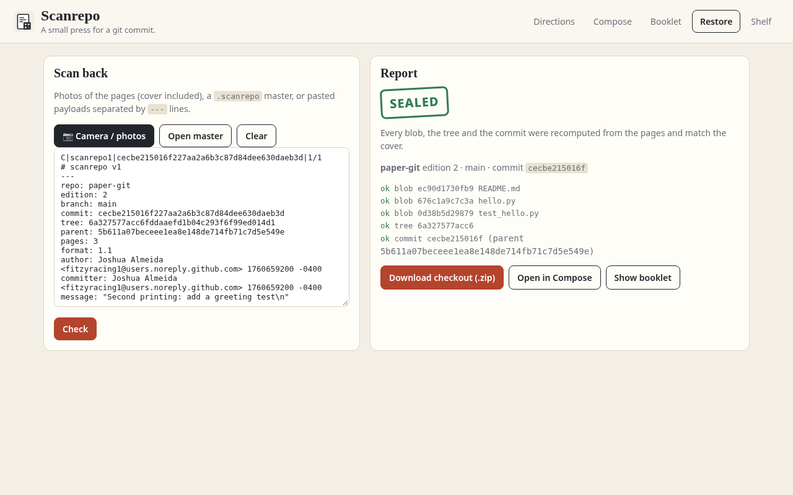

# Scanrepo (web)

**Live:** https://fitzyracing1.github.io/scanrepo-web/ · **Repo:** https://github.com/fitzyracing1/scanrepo-web

**A small press for a git commit.** Write the files, print a booklet, and scan it back into the same tree. Every file is rehashed the git way (`blob <len>\0` + bytes), then the tree and the commit are recomputed and compared with the cover.




## Tabs

- **Directions** (opens first): Compose; Seal and print (cover, `C|`/`P|` codes, Print, Master, Keep); Photograph (cover included, don't crop the codes, camera or paste, the `---` line between payloads); the report (**Sealed**, **Held**, **Rejected**, **Unread**, and why `paper-git` stays Held); the next edition; what doesn't belong on the page.
- **Compose**: repo, edition, branch, parent, message, author, time and zone; files with mode `100644`/`100755`/`120000`, typed or uploaded (binaries refused). Live byte/line/page counts per file. **Seal edition**, **New edition** (bumps edition, parent = this commit), **Load paper-git sample**.
- **Booklet**: a printable cover plus one page per chunk (≤ 1800 bytes / 72 lines, split at line ends), each with its source and a QR code. **Print** (letter, one booklet page per sheet), **Master** (downloads the `.scanrepo` file), **Keep** (shelf), and **Test the codes**, which decodes every QR on screen with jsQR and restores from them.
- **Restore**: camera/photos (decoded on-device via `BarcodeDetector` when available, else jsQR), open a master, or paste payloads separated by `---`. Report with per-object log; **Download checkout (.zip)** keeps exec bits; open the result in Compose or as a booklet.
- **Shelf**: editions kept in this browser (open, download master, remove).

## Format compatibility

This implements the `scanrepo` v1 format (1.1 keys: `format`, `size`, `author`, `committer`, `message`, `commit_extra`, `parents`, `_b64` variants, `OMITTED` block, legacy 1.0 pages without `size`) from [fitzyracing1/scanrepo-action](https://github.com/fitzyracing1/scanrepo-action). Checked while building:
- the bundled `paper-git` edition 1 sample restores **Held** with the published blob and tree ids,
- a master sealed here verified **commit_verified True** with the action's Python `core.verify`,
- `npm test` checks tree and commit ids against real `git` (same files, author, date, message).

## Run it

```sh
python3 -m http.server 8080      # open http://localhost:8080 (add ?demo to seal edition 2 and self-test the codes)
npm test                         # node --test, zero dependencies
```

GitHub Pages: `.github/workflows/pages.yml` deploys the repo root on push to `main`.

## Limits and choices

- Text files only; binaries, submodules and >100 KB files belong in an `OMITTED` block (restore honours one in a master; Compose doesn't create them).
- QR codes are byte mode, error correction M (L if needed), without the ECI 26 header the spec recommends. The vendored generator doesn't emit ECI. Payloads are UTF-8 and jsQR/zbar/phone scanners read them fine in testing; strict ECI-aware readers may still want it.
- On-screen decode is tested; photos of real paper depend on the camera and print quality (print at 100%, shoot flat).
- One commit per edition; parents are on the cover but earlier editions are not, so a restored checkout is a snapshot (the shelf is the history).

## Origin

Built from Joshua Almeida's Grok chat "Build web app from evidence" (https://grok.com/c/330f8474-f28c-4b5e-b2df-50825f9f78ef, Oct 7, 2026; attachment `scanrepo.zip`). The original zip isn't in the capture. The format came from the public `scanrepo-action` repo.

## License

MIT, see [LICENSE](LICENSE). Vendored: `vendor/qrcode.js` (qrcode-generator, MIT, © Kazuhiko Arase), `vendor/jsQR.js` (jsQR, Apache-2.0, © Cosmo Wolfe).
